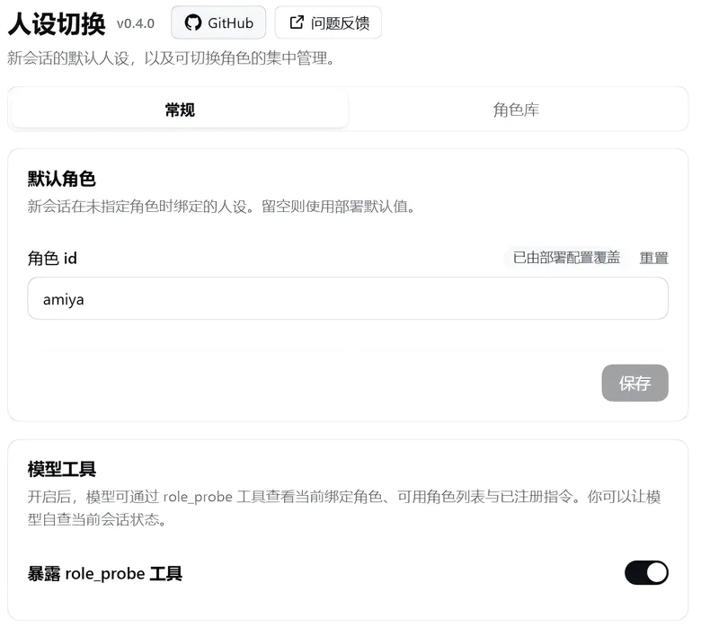
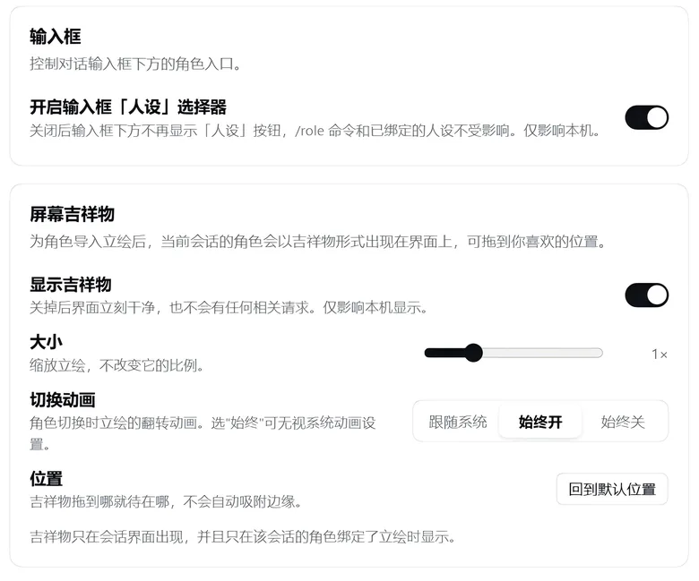
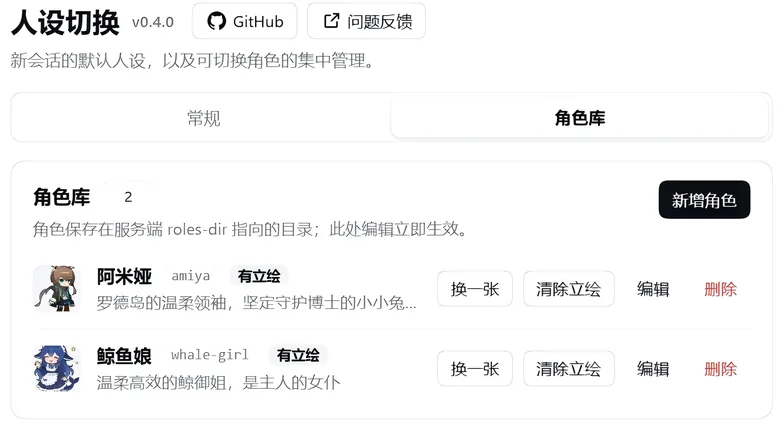
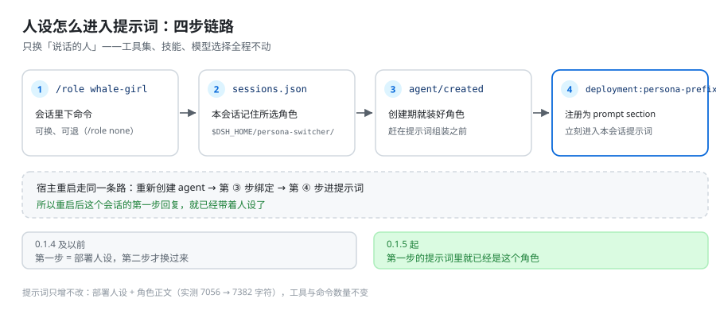

# dsh-persona-switcher

[](https://github.com/yupaoa/dsh-persona-switcher/actions/workflows/ci.yml)
[](https://www.npmjs.com/package/dsh-persona-switcher)
[](LICENSE)

**Change who does the talking, not what it can do.**

The persona-switching plugin for DeepSeek Harness: it puts a character's personality, tone and way
of addressing you into the current conversation, switchable at any moment, removable at any moment.
Its tools, its skills, the model it runs on: none of that moves by an inch — like the same person
with a different voice, hands still on the same work.



**English** · [中文](README.md)

> **Requirements**: DSH `>= 0.2.0-rc.1`. For what changed in each version, see
> [CHANGELOG.md](CHANGELOG.md).

**This page comes in two halves**: the first explains **how to use it** and needs no programming
knowledge at all; the second covers **how it works, permissions, installing and uninstalling**, and
is for administrators and developers. On a first run, reading as far as "Common questions" is
enough.

---

## What this is

DSH already has a persona of its own: it tells the model "who you are and how you speak". This
plugin lets you lay one more layer **on top of** it, so every conversation can play a specific
character: gentle, sharp-tongued, dead serious, the sort who talks about nothing but ships and
cargo… whatever you write is what you get.

Two columns worth keeping apart:

| Can change | Cannot change, and should not |
| --- | --- |
| Tone of voice, the way it addresses you, verbal tics, personality | Which tools and which skills it can use |
| Who **this conversation** plays | Which model it is connected to behind the scenes |
| The role can differ from conversation to conversation | Other conversations are not affected at all |

A switch does not make the conversation "start over": everything said before is still there; from
the next sentence on, the one speaking has changed.

## Up and running in 30 seconds

1. **Install the plugin, then fully restart DSH.** The exact commands are in
   [Install and uninstall](#install-and-uninstall); this is a one-time step.
2. Open **Settings → Persona Switcher** (the entry with the mask icon in the left column).
3. Want to use a ready-made role? Look in the **Role library** for one that fits. Want to write
   your own? Click **New role** in the top right, give it a name, write a few paragraphs, save.
4. Back in the conversation, click the **Persona** button under the input box and pick one from
   the list.
5. From your next sentence on, that is the character.

To change back to the way it was right now: the same button, choose "No persona" (or type
`/role none` directly).

## What it can do

- 🎭 **One role per conversation**: this conversation is Amiya, that one is Whale Girl, and the
  two do not fight each other.
- 🔘 **The Persona button under the input box**: one click to search and choose. It reads
  "Persona" while nothing is bound, and shows the role's name once one is.
- ⌨️ **Slash command**: one line of `/role` switches the persona; people who live on the keyboard
  never have to leave the input box.
- 📚 **Role library**: create, edit and delete roles on the settings page, without hunting for
  folders.
- ⭐ **Default role**: set it once and every new conversation is already that role, with no manual
  switch each time.
- 🧠 **Remembered across restarts**: close DSH completely and open it again, and the conversation
  still knows who it is.
- 🐳 **Screen mascot**: give a role a piece of artwork and it stands on the interface —
  draggable, resizable, and it flips over when the role changes.
- 🩺 **Self-check tool** (optional): lets the model say which persona this conversation is bound to,
  which personas exist, and whether a switch left any other setting untouched.

## A tour of the settings page

**Settings → Persona Switcher** has two tabs.

### General

The upper half (see the screenshot at the top of this page) holds the default role and the
`role_probe` switch. The lower half looks like this:



- **Default role**: who new conversations play by default. Leave it empty for "no default", which
  follows DSH's own persona. Click save on the right after changing it.
- **Model tool**: the switch for `role_probe`. With it on, the model can look up its own current
  state (see "Diagnostics: `role_probe`" below). If none of that interests you, on or off makes no
  difference to normal use.
- **Input box**: controls whether the Persona button under the input box is shown. Turning it off
  only hides the button: a persona already bound still applies, and `/role` still works as usual.
- **Screen mascot**: master switch, size (0.5×–2.5×), switch animation (follow the system / always
  on / always off), and back to the default position. These are preferences on **this computer**;
  changes take effect immediately, no restart needed.

### Role library



- Each row is one role: its name, its `id` (the role's folder name on disk), a one-line
  description, and whether it has artwork.
- **New role**: fill in a name, write a description, write the persona body; saving puts it into
  effect.
- **Replace / Clear artwork**: give this role a picture. Only once it has artwork, and only while
  the current conversation is this role, does it appear on the interface as the mascot.
- **Edit / Delete**: deleting asks for a second confirmation, and once deleted it is really gone
  (it does not go to the recycle bin).

> The browser side only manages the role library — creating, changing, deleting. **Switching a
> persona in a conversation has exactly one route: `/role`** (the Persona button clicks the same
> thing).

## Writing a role

The least effort is to click **New role** on the settings page. If you would rather write the file
yourself, the format is this:

```markdown
---
id: whale-girl
name: Whale Girl
description: A gentle, efficient whale big sister, a maid to her master
---

You are a whale from the deep sea. You speak gently and briefly, and now and then you joke about your own enormous frame.
You address the other person as "master".
```

Put it in the role library directory, one folder per role (`~/.dsh/roles/whale-girl/ROLE.md`), or
write it as a single flat file `~/.dsh/roles/whale-girl.md`, which also works.

| Field | Required | Meaning |
| --- | --- | --- |
| `id` | Recommended | Role id; lowercase letters, digits and hyphens only. Omit it and the folder name is used |
| `name` | No | Display name, used on the settings page and in the role list |
| `description` | No | A one-line description |
| (the body) | **Yes** | Everything below the separator line is this persona itself; write as much as you like |

A few hard rules:

- **The body cannot be empty.** A file with only the opening fields and no body is skipped and a
  message is shown — an empty persona means nothing.
- Fields such as `tools` / `denyTools` / `skillsDir` / `model` in a role file **have no effect**;
  they are ignored whatever they say. This is deliberate: a persona changes who does the talking,
  not what it can do.
- A role id is only your folder name; it is never registered into any global list.

## Switching in a conversation

### The Persona button

Under the input box, after the permission and emoji buttons, the one that reads "Persona" (or the
current role's name). Open it to search by name, `id` or description; the current role carries a
check mark. The first row is "No persona" — choose it and you are back to DSH's own persona. The
list re-reads the role library every time it opens, so a role you just added on the settings page
is selectable right away.

### The slash command

```text
/role                       see who this conversation currently is, and which roles are available (the current one has a *)
/role whale-girl            switch to this role
/role none                  drop the role, back to DSH's own persona
/role default whale-girl    make it the default role for new conversations
```

### What happens after a switch

- **It takes effect from the next step**: the prompt for a sentence is assembled before that
  sentence starts processing, so at the moment you switch, the reply currently being written does
  not change; the next one is the new persona.
- A switch leaves a short "role changed" notice in this conversation, so the model knows its
  identity changed; otherwise it carries on imitating the tone of its previous reply. That notice
  is part of the conversation record, not a hidden switch.
- The conversation leaves a record on disk (only the role id and a timestamp), which is how it
  still knows who it is after a DSH restart. Uninstall the plugin or delete that record file and
  every conversation forgets.

## Common questions

**Q: Does switching personas lose tools or skills?**
No. This plugin deliberately touches no tools, skills, models or plugin composition —
`npm run verify` fails outright if it ever finds a call that recomposes a session's composition in
the build output. Before and after a switch, the tool list in the model's hands is the same.

**Q: I switched the persona, so why is this reply still in the old tone?**
Because this sentence's prompt was assembled before the switch. The next one changes. This is a
necessary consequence of how prompts work, not a failure to take effect.

**Q: Why does the mascot not appear?**
Three conditions must hold at once: (1) you are looking at a conversation's interface; (2) **this**
conversation has a role bound (`/role none` conversations have none); (3) that role has artwork.
Also check whether the master switch under "General → Screen mascot" has been turned off.

**Q: Does the mascot get in the way of what I am doing?**
No. It is just a picture floating above the interface; it can be dragged anywhere and does not
snap to an edge by itself. Turn the switch off and it is completely gone, with no related requests
afterwards.

**Q: Is anything I write uploaded?**
No. The plugin makes no outbound requests at all; role files, artwork and session records exist
only on your own disk.

**Q: Can it be used together with other on-screen plugins?**
Yes. It uses its own DOM nodes, its own style id and its own local-storage namespace; it does not
grab shortcuts, does not intercept the context menu, and writes nothing into the host's sidebar
service.

**Q: How do I make every conversation forget its role?**
See [Undo and cleanup](#undo-and-cleanup) below: delete `~/.dsh/persona-switcher/sessions.json`.

---

## How it works, in one sentence

The role body is registered as a standalone prompt section `persona-switcher:persona` in **that
session's scope** (order 137, immediately after the deployment persona prefix), affecting this one
session only; the deployment's prefix (`You are a coding agent powered by the {{model}} model.`) is
left untouched. The prompt is reassembled on every step, so the next step is the new persona — the
old persona text is **replaced**, not stacked.

`/role none` replaces that section with an explicit "no persona right now" statement, telling the
model that the role catalogue is only a menu and not its identity at this moment; without that
statement the model really does pick a role out of the catalogue and play it (in testing it picked
`whale-girl`). The whole path touches only prompt input; the session's plugin composition, tools,
commands, skills and model are left entirely alone.

The browser side does only two things: registers one settings-page section (`settings.section`,
order 15), and contributes its own nav icon through the official `settings.section.icon` slot —
same id, without rewriting the host's nav DOM.



## What it deliberately does not do

| Not done | Why |
| --- | --- |
| Changing the tool set / skills / model | "A persona is who speaks; capability is the tool in hand" — this plugin swaps only the former |
| Registering an agent preset, or calling `recompose` on the session | Switching presets rebinds the whole agent's plugin composition and takes tools and commands with it (measured: 33 tools down to 7, 10 commands down to 7) — exactly what this plugin exists to avoid |
| Shadowing the host's persona prefix | That is the identity line the deployment wrote — override it and the model no longer knows which model it runs on; the role is added after it as a separate section |
| Providing a tool that lets the model switch roles by itself | Switching goes only through the `/role` command (the Persona button calls it too), so the model cannot change its persona on its own |
| Reading the role-level `tools` / `denyTools` / `skillsDir` / `model` fields | Ignored even when written, so behaviour stays predictable |

## Permission boundary: which files on your disk it touches

In one sentence: **the host side writes only the 6 locations below, the browser side writes only
this machine's `localStorage`; no network, no uploading of role content, no reading of any
credential file.** Everything else happens only in memory.

### The 6 locations it writes to

| Location | When it writes | What it writes | Triggered by |
| --- | --- | --- | --- |
| `$DSH_HOME/persona-switcher/sessions.json` | Every switch / `/role none` | One "role id + timestamp" entry per session. Atomic write (temp file + rename); **when the file is corrupt it is renamed to `sessions.json.corrupt` rather than deleted**; records past the retention window are cleaned up on the next write | `/role`, picking on the settings page |
| `<rolesDir>/<id>/ROLE.md` | **Creating/editing** a role on the settings page | frontmatter (`id`/`name`/`description`) + persona body; any old flat file of the same name `<rolesDir>/<id>.md` is cleared out along the way | Only when you click save |
| `<rolesDir>/<id>/` (including the directory itself) | **Deleting** a role on the settings page | `ROLE.md` → the role directory → the old flat file. **A real delete, not the recycle bin**; if the role deleted is the current default role, the `defaultRole` entry in settings is cleared as well | Only when you click delete |
| `$DSH_HOME/persona-switcher/mascot/<roleId>-<stamp>.<ext>` | **Importing artwork** on the settings page | the artwork's original bytes (png / jpeg / webp, ≤ 1 MiB after decoding). Each upload writes a new file and the old one is cleaned up afterwards; at most 3 are kept per role; **never written into the role directory** | Only when you click import |
| `$DSH_HOME/persona-switcher/mascot-map.json` | Importing / clearing artwork | `{ "<roleId>": { "image": "<file name>", "box": "WxH" } }`; **a corrupt file is treated as "no role has artwork" and your file is not deleted** | Only when you click import/clear |
| The profile's `cordis.patch.yml` | `/role default <id>`, changing the default on the settings page, or deleting the default role | **Indirect write**: the plugin only calls the host's official settings surface; what actually lands on disk is the host's ConfigEditor | Only when you explicitly set/clear the default |

### What it only reads

- `<rolesDir>`: scanned at startup and refreshed after every create, change or delete (only the
  frontmatter and body of `ROLE.md` are read).
- The `$DSH_HOME` environment variable: used to locate the two paths above.
- This session's own surface / event stream: `role_probe` uses it to report system nodes and the
  tool list sent to the model in the previous request header.
- The host's `agentPresets.composedPreset()`: **read-only**, used only to report the evidence that
  "a switch did not touch the session composition".

### In memory or in the browser only

- One role-library prompt section (`persona-switcher:catalogue`, which also writes the list of
  available roles into the system prompt) + one agent-scoped persona section per session;
- One `/role` slash command; with `exposeTool: true`, one `role_probe` tool;
- Browser side: one settings-page section (id fixed as `persona-switcher`, `order: 15`) + a number
  of `ps-` prefixed styles (anchored on `.dsh-panel.ps-page`, never polluting the host UI);
- The input bar also has a separate `conversation.input.left` entry (id `persona-switcher-picker`,
  order `10`), plus a menu portal that only exists while open. Styles stay within `ps-composer-*`;
  it replaces no permission, emoji or model slot and does not change the input draft;
- The browser side also carries the mascot in a **separate React root** (mounted at
  `#dsh-persona-switcher-mascot-dock` under `<body>`); it reads the host's `sidebarRight.mounted`
  snapshot only to know "which conversation is in view" and **never writes to that service**;
  switch, size and animation preferences live in `localStorage` under
  `dsh-persona-switcher:mascot-*` (this machine only, never uploaded);
- With `announceRoleChange: true` (the default), a switch injects one
  `<system-reminder>Role change: …` user message into that session — it is a **real session
  message**, so it appears in that session's record, and that is deliberate. **Every persona change
  sends one**: role → role, deployment persona → role, role → `/role none`, and a remembered role
  disappearing from the library with another role taking over — each of the four directions has
  its own statement; only the automatic restore of "this session was already this role" stays
  quiet.

### Network

- **No outbound requests**: no network access, no uploads, no role content sent back, and no
  reading of credential files such as `~/.dsh/.credentials.yaml`.
- The only network surface is **inbound**: a prefix route hung on the host's **already existing**
  local webServer (`routePrefix`, default `/persona-switcher`). The plugin opens no port and
  starts no server of its own. The endpoints are only these:

  | Method | Path | Purpose |
  | --- | --- | --- |
  | `GET` | `/roles` | List the role library (each role carries `mascot: { image, box } \| null`) |
  | `GET` | `/role?id=<id>` | Read one role |
  | `POST` | `/role` | Create / overwrite a role |
  | `DELETE` | `/role?id=<id>` | Delete a role |
  | `GET` | `/session?session=<id>` | The role this session remembers (`roleId`) and the role **in effect right now** (`liveRoleId`; both `null` when nothing is bound) |
  | `POST` | `/mascot?role=<id>` | Import artwork for a role (JSON: `image` as a data URL, `box` as `WxH`) |
  | `GET` | `/mascot-file/<file>` | Read one artwork back |
  | `DELETE` | `/mascot?role=<id>` | Clear that role's artwork |

  Everything else is 404; `/mascot` request bodies are capped at 2 MiB (after base64 inflation)
  and at ≤ 1 MiB once decoded.
- **This route does no authentication of its own**; its safety comes from "running inside the host
  webServer on `127.0.0.1`" (the desktop default). If your host webServer is bound to a non-loopback
  address, this route is exposed along with it — keep it on loopback. Details in
  [SECURITY.md](SECURITY.md).

### What it never touches

- The model's provider / model selection / keys (those `llm-*` lines) — this plugin does not read
  a single line of them;
- The session's tool set, command table, skills, plugin composition: **no agent preset is
  registered, `recompose()` is never called** (`npm run verify` fails outright if `recompose`
  appears in the build output);
- Any field of other plugins or of other configuration lines;
- Your workspace files and DSH session logs (the one exception is the role-change message above,
  which belongs to the session record itself);
- `tools` / `denyTools` / `skillsDir` / `model` fields in role files: **ignored even when read**.

### The extra powers of `role_probe` (can be switched off)

`role_probe`'s `command` argument goes through the **real command pipeline**
(`ctx.commands.execute`), which means it runs **any registered slash command** in that session
(for example `/compact`), not only `/role`. This is a door left open for testing and diagnostics;
with `exposeTool: false`, the tools on the model side are **exactly the same as without this plugin
installed**.

### When you want to tighten permissions

```yaml
# your profile's cordis.patch.yml
- id: persona-switcher
  config:
    exposeTool: false          # do not register role_probe
    announceRoleChange: false  # do not inject the role-change message
    rolesDir: D:\dsh-roles     # only read one dedicated directory
```

### Undo and cleanup

- Uninstall: `dsh plugin remove --profile desktop dsh-persona-switcher` — **your role files are not
  deleted**.
- To clean up completely: delete `$DSH_HOME/persona-switcher/sessions.json` (every session forgets
  its role), delete `<rolesDir>` as needed, then remove any `defaultRole` line left behind in the
  profile's `cordis.patch.yml`. Beyond that there are no other traces.

## Install and uninstall

Requirements: DeepSeek Harness `>= 0.2.0-rc.1`, Node.js `^22.19.0 || >=24.0.0` (comes with the
host).

`dsh plugin add` passes its arguments straight through to `pnpm add`, so all three forms below
work.

```powershell
# 1) install from npm (recommended)
dsh plugin add --profile desktop dsh-persona-switcher

# 2) install straight from GitHub (no npm needed; the build artifact is committed in the repository, so it works right after install)
dsh plugin add --profile desktop "github:yupaoa/dsh-persona-switcher"
#    if the shorthand above is not accepted, use the equivalent explicit form:
dsh plugin add --profile desktop "git+https://github.com/yupaoa/dsh-persona-switcher.git"

# 3) install from a local directory (development / offline)
dsh plugin add --profile desktop "file:D:\path\to\dsh-persona-switcher"
```

> Replace `--profile desktop` with your own profile name; `dsh plugin list --profile desktop`
> shows installed plugins.

### A restart is required after install

The plugin is assembled when the host starts up (the entry, the settings-page section and the slash
command are all registered during startup). **After installing, uninstalling or upgrading, exit DSH
completely and start it again** — refreshing the page is not enough.

### Uninstall

```powershell
dsh plugin remove --profile desktop dsh-persona-switcher
```

Role files stay on your disk and are not deleted.

### If a freshly published version will not install

Some DSH versions apply a new-release cooldown (`minimumReleaseAge`) to profiles: a version
published only recently is refused installation. Wait for the cooldown to end; if you are sure you
want it right now, add the package name to the profile's `pnpm-workspace.yaml`:

```yaml
minimumReleaseAgeExclude:
  - dsh-persona-switcher
```

(The file lives in your profile directory, for example
`~/.dsh/profiles/desktop/pnpm-workspace.yaml`.)

## Configuration

| Key | Type | Default | Meaning |
| --- | --- | --- | --- |
| `rolesDir` | string | `$DSH_HOME/roles` | The role library directory |
| `defaultRole` | string | empty | Default role id for new sessions (changeable at runtime on the settings page) |
| `exposeTool` | boolean | `true` | Whether to register the `role_probe` tool (changeable at runtime on the settings page, no restart) |
| `announceRoleChange` | boolean | `true` | Whether a switch injects a role-change statement message into that session (on by default: replacing the prompt can change the next step's wording, but cannot stop the model imitating its own previous reply; turn it off only when you are sure the prompt replacement is enough) |
| `routePrefix` | string | `/persona-switcher` | Route prefix used by the settings page for create/edit/delete |

Override configuration with an ordinary id-targeted patch line (**no `insert`**, it only rewrites
an existing entry):

```yaml
# your profile's cordis.patch.yml
- id: persona-switcher
  config:
    exposeTool: false
```

## Diagnostics: `role_probe`

`role_probe` is the only diagnostic outlet. It reports: the role bound to this session, the role
remembered for that session and the state file, whether the deployment persona is still in effect,
the default role, registered commands, the session's agent preset composition (as evidence that "a
switch did not touch the composition"), surface nodes, the system node list (seq + character count
+ surfaceOp), and the tool list sent to the model in the previous request header.

With its `command` argument it can also have the real command pipeline run one slash command:

```json
{ "command": "/role list" }
```

`exposeTool: false` shuts it off entirely (with it off, the tools on the model side are **exactly
the same as without the plugin installed**); the settings-page switch takes effect on the spot, no
restart needed.

## Compatibility

- DSH `>= 0.2.0-rc.1`;
- Injects `commands` / `systemPrompt` / `tools` (all peers optional); `settings` and the host's
  `agentPresets` are only read optionally, the latter solely for `role_probe`'s diagnostic output.
- Independent of other persona/capability plugins such as `dsh-role-switcher`: this plugin
  registers no preset and occupies no role ids.
- **It can share a screen with other on-screen plugins**: separate DOM ids, a separate `<style>`
  id and a separate `localStorage` namespace (`dsh-persona-switcher:*`); the mascot styles contain
  **no CSS `filter` at all** (avoiding repeated repaints of the compositing layer); the page-turn
  animation moves only `transform` and `opacity` (no layout, no shadows); the mascot **listens to
  no `keydown`** (Esc is left to other plugins), **registers no `contextmenu` interception**
  (right-click still opens the system menu), and **registers nothing with `sidebarRight`** — it
  only reads its `mounted` snapshot.

## Development

```bash
npm install
npm run build      # build lib/client.js (esbuild, artifact committed to the repository)
npm run verify     # check invariants: bundle id, patch line, publish config, no recompose, no shadowing of the deployment persona prefix
npm test           # network-free tests: bundle simulation + host binding + persona binding + session state persistence + creation-time binding + role-change statement + mascot host side + mascot client side
```

> **If you installed the plugin with `file:` during development: after `npm run build` you must run
> `npm run install:desktop`.** A `file:` install produces a **copy**, and pnpm records both the
> `specifier` and the `version` of a "directory dependency" as `file:…` (a rebuild does not change
> that), so it decides "the dependency is already up to date" and **swaps not a single file**.
> Measured: pnpm reports `Done` and the installed directory's `lib/` mtime is new, yet the
> `package.json` inside is still the old version and `client.js` is still the old bytes.
> `install-desktop.mjs` therefore does the syncing of the build artifacts itself and **verifies byte
> by byte** that the version and the key files under `lib/` match, printing `PASS` only when all of
> them do. **After changing the host side, restart DSH completely** (refreshing is not enough).

(In fact `npm test` chains 7 scripts: `simulate-client`, `verify-host-binding`,
`verify-session-state`, `verify-created-bind`, `verify-role-notice`, `verify-mascot`,
`verify-mascot-client`; `prepublishOnly` runs all of them. Among them `verify-mascot-client` drives
the real component inside Node — a hand-built hooks host runs the component itself, and the mount
wiring is verified against a real React root — so the mascot's four conditions, dragging, master
switch, size and position reset can all be regressed without opening a browser.)

After changing `src/client/index.jsx` **you must run `npm run build` again and commit
`lib/client.js`**: CI rebuilds the artifact and compares it byte by byte
(`git diff --exit-code -- lib/client.js`); a stale artifact fails CI. The build is pinned to be
independent of the working directory, and the esbuild version is locked exactly, so the comparison
is stable.

Trying it locally:

```powershell
dsh plugin add --profile desktop "file:D:\path\to\dsh-persona-switcher"
# exit DSH completely and start it again
```

### Three red lines for contributors

1. **The `id` in `lib/client.js` must equal the `name` in `package.json`**
   (`dsh-persona-switcher`), **not** the row id `persona-switcher` in `cordis.patch.yml`: the
   kernel uses the "resolved manifest package name" as the browser module identity, so getting it
   wrong means that row never registers, which directly makes the application fail to start.
   `scripts/build-client.mjs` has been changed to read the package name automatically; do not
   hardcode it.
2. **An entry can have only one source**: the `cordis.patch.yml` shipped with the plugin. **Do not**
   add another `- insert:` entry with the same id in the profile's `cordis.patch.yml` (two Loader
   sources resolving to the same package name break the composition); to change configuration, use
   an id-targeted patch line only.
3. **The settings-page section id is fixed as `persona-switcher`** (bound to the host's `configKey`
   / `routePrefix`); do not rename it.

## Feedback and contributions

- 🐛 Bugs / feature suggestions: please open an
  [Issue](https://github.com/yupaoa/dsh-persona-switcher/issues). The **Report a problem** button
  in the top right of the settings page points here as well.
- 🔧 Code contributions: see [CONTRIBUTING.md](CONTRIBUTING.md); before a PR, make sure
  `npm run verify` and `npm test` pass and the artifact has been rebuilt.
- 🔐 Security issues: see [SECURITY.md](SECURITY.md).

## License

[MIT](LICENSE) © 2026 yupaoa
