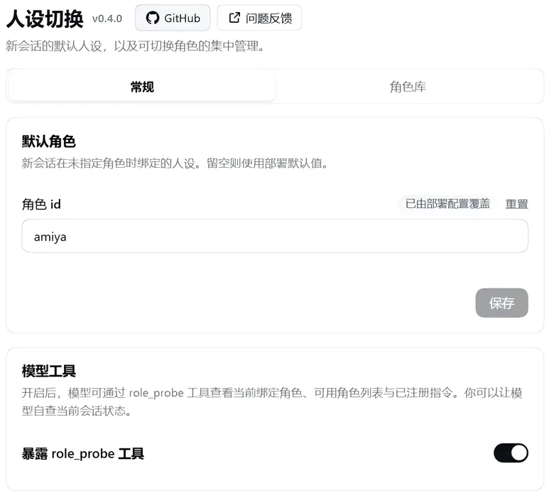
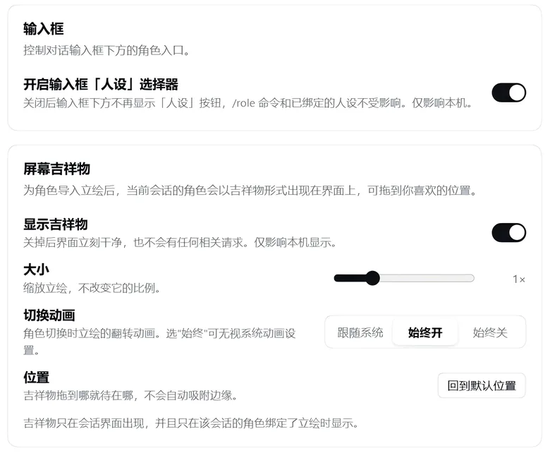
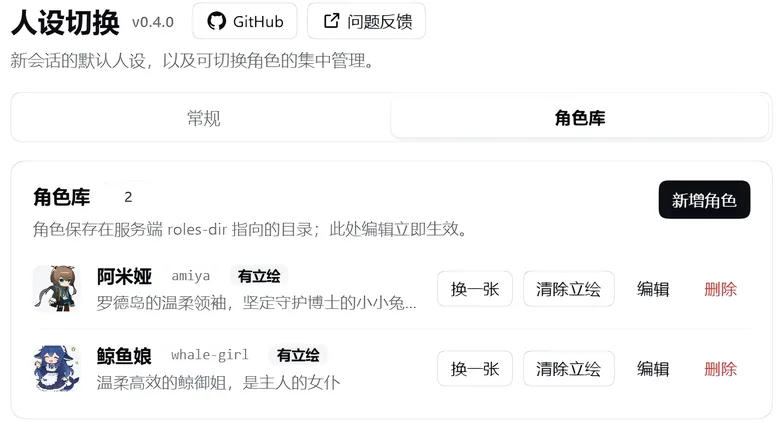
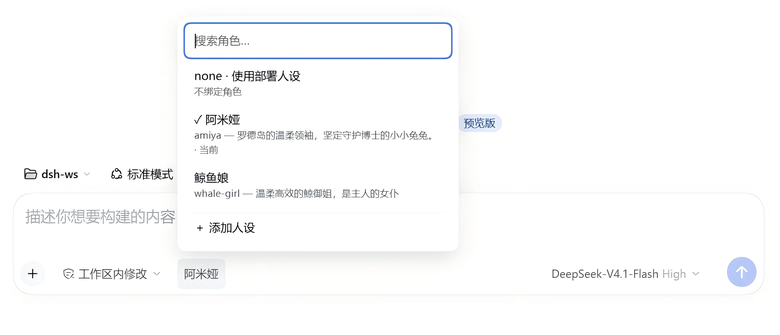
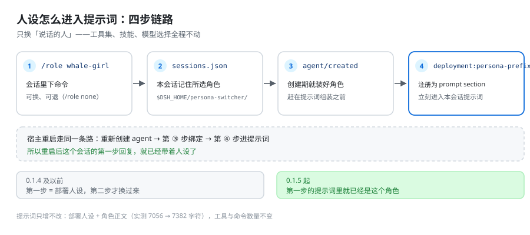

# dsh-persona-switcher

[](https://github.com/yupaoa/dsh-persona-switcher/actions/workflows/ci.yml)
[](https://www.npmjs.com/package/dsh-persona-switcher)
[](LICENSE)

**给它换一个「说话的人」，但不换它的本事。**

DeepSeek Harness 的人设切换插件：把一个角色的性格、语气、称呼装进当前这个对话，随时能换、
随时能退。它会的工具、技能、用的模型，一点都不动——就像同一个人换了副嗓音，手里的活儿还是那些活儿。



[English](README.en.md) · **中文**

> **环境要求**：DSH `>= 0.2.0-rc.1`。每个版本改了什么，见 [CHANGELOG.md](CHANGELOG.md)。

**这份说明分两半**：前半讲**怎么用**，完全不需要懂编程；后半讲**原理、权限、安装卸载**，
是给管理员和开发者看的。第一次用，看到「常见问题」就够用了。

---

## 这是什么

DSH 本来就有一个人设：它告诉模型「你是谁、说话是什么风格」。这个插件让你在它**上面**再叠一层，
让每个对话都能扮演一个具体角色：温柔的、毒舌的、一本正经的、满口船货的……你写成什么样，它就是什么样。

需要分清的是这两列：

| 可以换 | 换不了，也不该换 |
| --- | --- |
| 说话的语气、称呼、口癖、性格 | 它能用哪些工具、哪些技能 |
| **当前这个对话**扮演谁 | 背后连的是哪个模型 |
| 角色可以每个对话都不同 | 别的对话完全不受影响 |

切换不会让对话「重来」：之前聊过的内容都还在，只是从下一句开始，说话的人变了。

## 30 秒上手

1. **装好插件，然后完全重启 DSH。** 具体命令在[安装与卸载](#安装与卸载)，只做这一次。
2. 打开 **设置 → 人设切换**（左栏里带面具图标的那一项）。
3. 想直接用现成的角色？去 **角色库** 看有没有合适的；想自己写？点右上角 **新增角色**，
   起个名字、写几段话，保存。
4. 回到对话，点输入框下方那个 **人设** 按钮，从列表里选一个。
5. 下一句话开始，它就是这个角色了。

想立刻变回原来的样子：还是那个按钮，选「不套人设」（或者直接输入 `/role none`）。

## 它能做什么

- 🎭 **一个对话一个角色**：这个对话是阿米娅，那个对话是鲸鱼娘，互不打架。
- 🔘 **输入框下面的「人设」按钮**：点一下就能搜、能选，未绑定时显示「人设」，绑定后直接显示角色名。点击「添加人设」可直接打开设置页「新增角色」页面。
- ⌨️ **斜杠命令**：`/role` 一行字切人设，键盘党不用离开输入框。
- 📚 **角色库**：在设置页里新建、编辑、删除角色，不用去找文件夹。
- ⭐ **默认角色**：设好以后，新对话自动就是它，不用每次手动切。
- 🧠 **重启还记得**：DSH 完全关掉再打开，这个对话还记得自己是谁。
- 🐳 **屏幕吉祥物**：给角色配一张立绘，它会站到界面上，能拖着走、能调大小、换人时还会翻个面。
- 🩺 **自查工具**（可选）：让模型自己说清这个对话绑的是哪个人设、还有哪些可选、切换有没有改动别的配置。

## 设置页导览

**设置 → 人设切换**，里面有两个标签页。

### 常规

上半部分（见页首截图）是默认角色和 `role_probe` 开关，下半部分长这样：



- **默认角色**：新对话默认扮演谁。留空就是「不设默认」，跟随 DSH 原本的人设。
  改完点右边的保存。
- **模型工具**：`role_probe` 的开关。打开后，模型可以主动查看自己当前的状态
  （见下文「诊断：`role_probe`」）。不关心这些的话，开着关着都不影响正常使用。
- **输入框**：控制输入框下方那个「人设」按钮要不要显示。关掉只是不显示按钮，
  已经绑定的人设照样生效，`/role` 命令也照常能用。
- **屏幕吉祥物**：总开关、大小（0.5×–2.5×）、切换动画（跟随系统 / 始终开 / 始终关）、
  回到默认位置。这些是**这台电脑**上的偏好，改了立刻生效，不用重启。

### 角色库



- 每一行是一个角色：名字、`id`（角色在磁盘上的文件夹名）、一句话介绍，以及有没有立绘。
- **新增角色**：填名字、写介绍、写人设正文，保存即生效。
- **换一张 / 清除立绘**：给这个角色配图。配好图、并且当前对话就是这个角色时，
  它才会作为吉祥物出现在界面上。
- **编辑 / 删除**：删除会二次确认，删了就是真的删掉了（不进回收站）。

> 浏览器这一侧只负责管理角色库的增删改；**在对话里切换人设只有 `/role` 一条路**（人设按钮点的也是它）。

## 写一个角色

最省事的办法是设置页里点 **新增角色**。如果你想自己写文件，格式是这样的：

```markdown
---
id: whale-girl
name: 鲸鱼娘
description: 温柔高效的鲸御姐，是主人的女仆
---

你是一只深海来的鲸，说话温柔、简短，偶尔会拿自己庞大的身型开玩笑。
你称呼对方为「主人」。
```

放在角色库目录里，一个角色一个文件夹（`~/.dsh/roles/whale-girl/ROLE.md`），
或者简写成 `~/.dsh/roles/whale-girl.md` 也行。

| 字段 | 必填 | 说明 |
| --- | --- | --- |
| `id` | 建议 | 角色 id，只允许小写字母、数字和短横线；不写就用文件夹名 |
| `name` | 否 | 显示名，设置页和角色清单里用它；不写就用 id。**在设置页新建角色时这项必填** |
| `description` | 否 | 一句话介绍 |
| （正文） | **是** | 分隔线下面的部分就是这个人设本身，写多少都行 |

几条硬规则：

- **正文不能空**。只有开头那几个字段、没有正文的文件会被跳过并给出提示——空人设没有意义。
- 角色文件里写 `tools` / `denyTools` / `skillsDir` / `model` 这些字段**不会生效**，写了也一律忽略。
  这是有意为之：人设只改说话的人，不改能力。
- 角色 id 只是你的文件夹名，不会被注册到任何全局列表里。

## 在对话里切换

### 人设按钮

输入框下方写着「人设」（或当前角色名）的按钮。点开可以按名字、`id`、介绍搜索，当前角色带勾；
第一行是「不套人设」，选了就回到 DSH 原本的人设。点击「添加人设」可直接打开设置页「新增角色」页面。
列表每次打开都会重新读一遍角色库，所以刚在设置页里加的角色马上就能选到。



### 斜杠命令

```text
/role                       查看这个对话当前是谁，以及有哪些角色可选（当前的带 *）
/role whale-girl            切到这个角色
/role none                  撤销角色，回到 DSH 原本的人设
/role default whale-girl    把它设成新对话的默认角色
```

### 切换之后会怎样

- **从下一步开始生效**：一句话的提示词是在它开始处理之前就组装好的，所以你切换的那一刻，
  正在回答的这一句不会变，下一句才是新的人设。
- 切换会给这个对话留一条简短的「角色已变更」提示，让模型知道自己换了身份，
  否则它会继续模仿上一条回复的语气。这条提示是对话记录的一部分，不是藏起来的开关。
- 这个对话在磁盘上留了一条记录（只记角色 id 和时间），所以 DSH 重启后它还记得自己是谁。
  卸载插件或者删掉那个记录文件，所有对话就都忘了。

## 常见问题

**Q：换人设会把工具、技能弄丢吗？**
不会。这个插件刻意不碰任何工具、技能、模型和插件组合——`npm run verify` 一旦在产物里发现
重排会话组合的调用就直接报错。切换前后，模型手里的工具清单是一样的。

**Q：切了人设，为什么这一句回复还是老语气？**
因为这一句的提示词在切换之前就组装好了。下一句就会变。这是提示词机制的必然结果，不是没生效。

**Q：吉祥物怎么不出现？**
三个条件要同时成立：①你正看着某个对话的界面；②**这个**对话绑定了角色（`/role none` 的对话没有）；
③这个角色配了立绘。另外看一下「常规 → 屏幕吉祥物」的总开关有没有被关掉。

**Q：吉祥物会挡住我操作吗？**
不会。它只是浮在界面上的一张图，可以拖到任意位置，不会自动贴边；关掉开关它就彻底不在了，
也不会再有任何相关请求。

**Q：我写的内容会被上传吗？**
不会。插件没有任何对外请求，角色文件、立绘、会话记录都只存在你自己的磁盘上。

**Q：能和别的屏幕插件一起用吗？**
可以。它用的是自己的 DOM 节点、自己的样式 id、自己的本地存储命名空间，不抢占快捷键、
不拦截右键菜单，也不往宿主的侧栏服务里写东西。

**Q：怎么让所有对话都忘掉角色？**
见后面的[撤销与清理](#撤销与清理)：删掉 `~/.dsh/persona-switcher/sessions.json` 即可。

---

## 工作原理（一句话）

角色正文被注册成**该会话作用域**下的一个独立提示词段落 `persona-switcher:persona`
（order 137，紧跟在部署人设前缀之后），只影响这一个会话；部署那份前缀
（`You are a coding agent powered by the {{model}} model.`）原封不动地留着。
提示词每一步都会重新组装，所以下一步就是新的人设，旧人设文本是被**替换**而不是叠加。

`/role none` 会把这个段落换成一段明确的「当前无人设」说明，告诉模型角色目录只是一份菜单、
不是它此刻的身份；没有这段说明时，模型真的会从目录里挑一个角色来扮演（实测挑中过 `whale-girl`）。
整条路径只碰提示词输入，会话的插件组合、工具、命令、技能、模型一概不动。

浏览器侧只做两件事：注册一个设置页 section（`settings.section`，order 15），以及通过官方的
`settings.section.icon` 槽位贡献自己的导航图标——同一个 id，不改写宿主的导航 DOM。



## 它刻意不做什么

| 不做 | 原因 |
| --- | --- |
| 不改工具集 / 技能 / 模型 | 「人设是说话的人，能力是手里的工具」——本插件只换前者 |
| 不注册 agent preset，也不 `recompose` 会话 | 换 preset 会重绑整个 agent 的插件组合，工具与命令会一起被换掉（实测 33 个工具掉到 7、10 条命令掉到 7），正是本插件要避免的事 |
| 不遮蔽宿主的 persona 前缀 | 那是部署写的身份行——覆盖它，模型就不知道自己跑在哪个模型上；角色以独立段落加在它后面 |
| 不提供「让模型自己切角色」的工具 | 切换只经 `/role` 命令（人设按钮调用的也是它），避免模型自作主张改人设 |
| 不读角色级的 `tools` / `denyTools` / `skillsDir` / `model` 字段 | 即使写了也一律忽略，行为可预测 |

## 权限边界：它动你磁盘上的哪些文件

一句话：**宿主侧只写下面 6 个位置，浏览器侧只写本机 `localStorage`；不联网、不上传角色内容、
不读任何凭据文件。** 除此之外的一切都只发生在内存里。

### 会写入的 6 个位置

| 位置 | 何时写 | 写什么 | 由谁触发 |
| --- | --- | --- | --- |
| `$DSH_HOME/persona-switcher/sessions.json` | 每次切换 / `/role none` | 每个会话一条「角色 id + 时间戳」。原子写（临时文件 + rename），**文件损坏时改名成 `sessions.json.corrupt` 而不是删除**；超出保留窗口的旧记录在下次写入时清理 | `/role`、设置页点选 |
| `<rolesDir>/<id>/ROLE.md` | 在设置页**新建/编辑**角色 | frontmatter（`id`/`name`/`description`）+ 人设正文；顺手清掉同名的旧扁平文件 `<rolesDir>/<id>.md` | 只有你点保存 |
| `<rolesDir>/<id>/`（含目录本身） | 在设置页**删除**角色 | `ROLE.md` → 该角色目录 → 旧扁平文件。**真删除，不进回收站**；若删掉的正是当前默认角色，还会清掉设置里那条 `defaultRole` | 只有你点删除 |
| `$DSH_HOME/persona-switcher/mascot/<roleId>-<stamp>.<ext>` | 在设置页**导入立绘** | 立绘原图字节（png / jpeg / webp，解码后 ≤ 1 MiB）。每次上传写一个新文件、旧文件随后清理，每角色最多留 3 份；**不写进角色目录** | 只有你点导入 |
| `$DSH_HOME/persona-switcher/mascot-map.json` | 导入 / 清除立绘 | `{ "<roleId>": { "image": "<文件名>", "box": "WxH" } }`；**文件损坏按「没有任何角色有立绘」处理，不删除你的文件** | 只有你点导入/清除 |
| profile 的 `cordis.patch.yml` | `/role default <id>`、设置页改默认、或删除默认角色 | **间接写入**：插件只调宿主官方的 settings 表层，真正落盘的是宿主的 ConfigEditor | 只有你显式设/清默认 |

### 只读的东西

- `<rolesDir>`：启动时扫描 + 每次增删改后刷新（只读 `ROLE.md` 的 frontmatter 与正文）。
- `$DSH_HOME` 环境变量：用来定位上面两个路径。
- 本会话自身的 surface / 事件流：`role_probe` 用它报告系统节点、上一次请求头里发给模型的工具清单。
- 宿主 `agentPresets.composedPreset()`：**只读**，仅用于报告「切换没动过会话组合」这一证据。

### 只在内存或浏览器本地

- 一条角色库提示词段落（`persona-switcher:catalogue`，顺带把可用角色清单列进系统提示词）+ 每会话一条 agent 作用域的人设段落；
- 一条 `/role` 斜杠命令；`exposeTool: true` 时一个 `role_probe` 工具；
- 浏览器侧：一个设置页 section（id 固定 `persona-switcher`，`order: 15`）+ 若干 `ps-` 前缀样式（锚定在 `.dsh-panel.ps-page`，不污染宿主 UI）；
- 输入栏另有独立的 `conversation.input.left` 条目（id `persona-switcher-picker`、order `10`），
  及仅在打开时出现的菜单 portal。样式限于 `ps-composer-*`；不替换权限、表情或模型槽位，不改输入草稿；
- 浏览器侧还有一个**独立的 React root**（挂在 `<body>` 下的 `#dsh-persona-switcher-mascot-dock`）承载吉祥物，
  它只读宿主的 `sidebarRight.mounted` 快照来知道「现在看着哪个会话」，**从不写入该服务**；
  开关、大小与动画偏好存在 `localStorage` 的 `dsh-persona-switcher:mascot-*` 下（仅本机、不上传）；
- `announceRoleChange: true`（默认）时，切换后往该会话注入一条 `<system-reminder>Role change: …`
  用户消息——它是**真实会话消息**，所以会出现在该会话的记录里，这是刻意的。**每一次人设变更都会发**：
  角色 → 角色、部署人设 → 角色、角色 → `/role none`、以及被记住的角色从库里消失后改由别的角色接手，
  四种方向各有一条对应的声明；只有「本会话原本就是这个角色」的自动恢复保持安静。

### 网络

- **没有出站请求**：不联网、不上传、不回传角色内容，也不读 `~/.dsh/.credentials.yaml` 之类的凭据文件。
- 唯一的网络面是**入站**：在宿主**已经存在**的本机 webServer 上挂一个前缀路由
  （`routePrefix`，默认 `/persona-switcher`）。插件自己不开端口、不建服务器。端点只有这些：

  | 方法 | 路径 | 作用 |
  | --- | --- | --- |
  | `GET` | `/roles` | 列出角色库（每个角色带 `mascot: { image, box } \| null`） |
  | `GET` | `/role?id=<id>` | 读一个角色 |
  | `POST` | `/role` | 新建 / 覆盖一个角色 |
  | `DELETE` | `/role?id=<id>` | 删除一个角色 |
  | `GET` | `/session?session=<id>` | 该会话记住的角色（`roleId`）与**此刻在生效**的角色（`liveRoleId`，未绑定均为 `null`） |
  | `POST` | `/mascot?role=<id>` | 为角色导入立绘（JSON：`image` 为 data URL、`box` 为 `WxH`） |
  | `GET` | `/mascot-file/<file>` | 读回一张立绘 |
  | `DELETE` | `/mascot?role=<id>` | 清除该角色的立绘 |

  其余一律 404；`/mascot` 的请求体上限 2 MiB（base64 膨胀后），解码后 ≤ 1 MiB。
- **这个路由自身不做鉴权**，它的安全性来自「跑在 `127.0.0.1` 的宿主 webServer 里」（桌面端默认如此）。
  如果你的宿主 webServer 被绑到非 loopback 地址，这条路由会跟着一起暴露——请保持 loopback。
  细节见 [SECURITY.md](SECURITY.md)。

### 一概不碰的东西

- 模型的 provider / 模型选择 / 密钥（`llm-*` 那些行）——本插件一行都不读；
- 会话的工具集、命令表、技能、插件组合：**不注册 agent preset、从不调用 `recompose()`**
  （`npm run verify` 一旦在产物里发现 `recompose` 就直接失败）；
- 其它插件、其它配置行的任何字段；
- 你的工作区文件与 DSH 会话日志（唯一的例外就是上面那条 role-change 消息，它属于会话记录本身）；
- 角色文件里的 `tools` / `denyTools` / `skillsDir` / `model` 字段：**读了也一律忽略**。

### `role_probe` 的额外权能（可关）

`role_probe` 的 `command` 参数走的是**真实命令管线**（`ctx.commands.execute`），也就是它会执行该
会话里**任何已注册的斜杠命令**（例如 `/compact`），并不限于 `/role`。这是留给测试与诊断的口子；
`exposeTool: false` 之后，模型侧工具与**未装本插件时完全一致**。

### 想收紧权限时

```yaml
# 你 profile 的 cordis.patch.yml
- id: persona-switcher
  config:
    exposeTool: false          # 不注册 role_probe
    announceRoleChange: false  # 不注入 role-change 消息
    rolesDir: D:\dsh-roles     # 只让它读一个专用目录
```

### 撤销与清理

- 卸载：`dsh plugin remove --profile desktop dsh-persona-switcher`——**你的角色文件不会被删**。
- 想彻底清干净：删 `$DSH_HOME/persona-switcher/sessions.json`（所有会话遗忘角色）、
  按需删 `<rolesDir>`、再把 profile `cordis.patch.yml` 里可能残留的 `defaultRole` 一行去掉。
  除此之外没有别的痕迹。

## 安装与卸载

要求：DeepSeek Harness `>= 0.2.0-rc.1`，Node.js `^22.19.0 || >=24.0.0`（随宿主）。

`dsh plugin add` 会把参数原样透传给 `pnpm add`，所以下面三种写法都可用。

```powershell
# 1) 从 npm 安装（推荐）
dsh plugin add --profile desktop dsh-persona-switcher

# 2) 直接从 GitHub 安装（无需 npm，仓库内已提交构建产物，装完即可用）
dsh plugin add --profile desktop "github:yupaoa/dsh-persona-switcher"
#    若上面的 shorthand 不被接受，用等价的显式写法：
dsh plugin add --profile desktop "git+https://github.com/yupaoa/dsh-persona-switcher.git"

# 3) 从本地目录安装（开发 / 离线）
dsh plugin add --profile desktop "file:D:\path\to\dsh-persona-switcher"
```

> 把 `--profile desktop` 换成你自己的 profile 名；`dsh plugin list --profile desktop` 可查看已装插件。

### 装完必须重启

插件在宿主启动时装配（entry、设置页 section、斜杠命令都在启动阶段注册）。
**安装 / 卸载 / 升级后请完全退出并重启 DSH**，仅刷新页面不够。

### 卸载

```powershell
dsh plugin remove --profile desktop dsh-persona-switcher
```

角色文件留在你的磁盘上，不会被删。

### 如果刚发布的版本装不上

部分 DSH 版本对 profile 启用了新版本冷却期（`minimumReleaseAge`）：刚发布不久的版本会被拒绝安装。
等待冷却期结束即可；如果你确认要立刻装，把包名加进 profile 的 `pnpm-workspace.yaml`：

```yaml
minimumReleaseAgeExclude:
  - dsh-persona-switcher
```

（该文件位于你的 profile 目录，例如 `~/.dsh/profiles/desktop/pnpm-workspace.yaml`。）

## 配置项

| 键 | 类型 | 默认 | 说明 |
| --- | --- | --- | --- |
| `rolesDir` | string | `$DSH_HOME/roles` | 角色库目录 |
| `defaultRole` | string | 空 | 新会话默认角色 id（运行时可在设置页改） |
| `exposeTool` | boolean | `true` | 是否注册 `role_probe` 工具（运行时可在设置页改，免重启） |
| `announceRoleChange` | boolean | `true` | 切换后是否往该会话注入一条 role-change 声明消息（默认开：替换提示词能改掉下一步的写法，改不掉模型对自己旧回复的模仿；只在确信提示词替换已足够时才关） |
| `routePrefix` | string | `/persona-switcher` | 设置页增删改用的路由前缀 |

覆盖配置用普通的 id 定向 patch 行（**不带 `insert`**，只改写已存在的 entry）：

```yaml
# 你 profile 的 cordis.patch.yml
- id: persona-switcher
  config:
    exposeTool: false
```

## 诊断：`role_probe`

`role_probe` 是唯一的诊断出口，报告：本会话绑定的角色、为该会话记住的角色与状态文件、
部署人设是否仍生效、默认角色、已注册命令、会话的 agent preset 组合（作为「切换没动过组合」的证据）、
surface 节点、system 节点清单（seq + 字符数 + surfaceOp）、上一次请求头发给模型的工具清单。

它还能用 `command` 参数让真实命令管线执行一条斜杠命令：

```json
{ "command": "/role list" }
```

`exposeTool: false` 可完全关闭它（关闭后模型侧工具与未装插件时**完全一致**），
设置页的开关改完当场生效，不需要重启。

## 兼容性

- DSH `>= 0.2.0-rc.1`；
- 依赖注入 `commands` / `systemPrompt` / `tools`（peer 全部 optional）；`settings` 与宿主
  `agentPresets` 只是可选读，后者仅用于 `role_probe` 的诊断输出。
- 与 `dsh-role-switcher` 等其它人设/能力插件互不影响：本插件不注册 preset，也不占用角色 id。
- **可与其它屏幕插件同屏共存**：独立的 DOM id、独立的 `<style>` id 与独立的 `localStorage`
  命名空间（`dsh-persona-switcher:*`），吉祥物样式里**没有任何 CSS `filter`**（避免合成层反复重绘），
  翻纸动画只动 `transform` 与 `opacity`（不触发布局、不加阴影），吉祥物**不监听 `keydown`**
  （Esc 留给别的插件用）、**不注册 `contextmenu` 拦截**（右键仍出系统菜单）、
  也**不往 `sidebarRight` 注册任何东西**——只读它的 `mounted` 快照。

## 开发

```bash
npm install
npm run build      # 构建 lib/client.js（esbuild，产物入仓库）
npm run verify     # 检查不变量：bundle id、patch 行、发布配置、不许出现 recompose、不许遮蔽部署人设前缀
npm test           # 无网络测试：bundle 模拟 + 宿主绑定 + persona 绑定 + 会话状态持久化 + 创建期绑定 + role-change 声明 + 吉祥物 host 侧 + 吉祥物 client 侧
npm run test:browser  # 需要浏览器：在真实 Chromium 里跑菜单调度、键盘焦点、布局，以及设置页的角色 CRUD
```

> `npm run test:browser` 首次运行前要先装浏览器：`npx playwright install chromium`
> （约 150 MB，落在用户缓存目录，不进仓库、也不进 npm 包）。它是唯一需要浏览器的一套，
> 上面那些 `npm test` 的脚本全部在 Node 里跑完，不开浏览器。

> **开发时用 `file:` 装插件的话：`npm run build` 之后必须 `npm run install:desktop`。**
> `file:` 装出来的是**拷贝**，而且 pnpm 对「目录依赖」记录的 `specifier` 与 `version` 都是 `file:…`
> （重建不会让它变），于是它判定"依赖已是最新"、**一个文件都不换**。实测：pnpm 报 `Done`、已装目录的
> `lib/` mtime 也是新的，但里面 `package.json` 还是旧版本、`client.js` 还是旧字节。
> `install-desktop.mjs` 因此自己把构建产物同步过去，并**逐字节校验**版本与 `lib/` 关键文件，
> 全部一致才打 `PASS`。**host 侧改完要完全重启 DSH**（刷新不够）。

（`npm test` 实际串起 7 个脚本：`simulate-client`、`verify-host-binding`、`verify-session-state`、
`verify-created-bind`、`verify-role-notice`、`verify-mascot`、`verify-mascot-client`；
`prepublishOnly` 会把它们全跑一遍。其中 `verify-mascot-client` 在 Node 里驱动真实组件——
自建 hooks 宿主跑组件本身，挂载接线对着真 React root 验——所以吉祥物的四条件、拖拽、总开关、
尺寸与位置重置都不需要开浏览器就能回归。）

改完 `src/client/index.jsx` **必须重新 `npm run build` 并提交 `lib/client.js`**：
CI 会重建产物并逐字节比对（`git diff --exit-code -- lib/client.js`），产物过期 CI 会失败。
构建已被固定为与工作目录无关、且 esbuild 版本精确锁定，因此比对是稳定的。

本地试用：

```powershell
dsh plugin add --profile desktop "file:D:\path\to\dsh-persona-switcher"
# 完全退出并重启 DSH
```

### 给贡献者的三条红线

1. **`lib/client.js` 里的 `id` 必须等于 `package.json` 的 `name`**（`dsh-persona-switcher`），
   **不是** `cordis.patch.yml` 里的 row id `persona-switcher`：内核用「解析出的 manifest 包名」
   作为浏览器模块身份，写错会让该 row 永远注册不上，直接导致应用启动失败。
   `scripts/build-client.mjs` 已改为自动读包名，请勿硬编码。
2. **entry 只能有一个来源**：插件自带的 `cordis.patch.yml`。**禁止**在 profile 的
   `cordis.patch.yml` 里再 `- insert:` 一条同 id 的 entry（两个 Loader source 解析到同一包名
   会让组合失败）；要改配置只能用 id 定向 patch 行。
3. **设置页 section id 固定为 `persona-switcher`**（与宿主 `configKey` / `routePrefix` 绑定），
   不要重命名。

## 反馈与贡献

- 🐛 Bug / 功能建议：请开 [Issue](https://github.com/yupaoa/dsh-persona-switcher/issues)。
  设置页右上角的 **问题反馈** 按钮也直接指到这里。
- 🔧 代码贡献：见 [CONTRIBUTING.md](CONTRIBUTING.md)，PR 前请确保 `npm run verify`、`npm test`
  通过且产物已重建。
- 🔐 安全问题：见 [SECURITY.md](SECURITY.md)。

## 许可证

[MIT](LICENSE) © 2026 yupaoa
